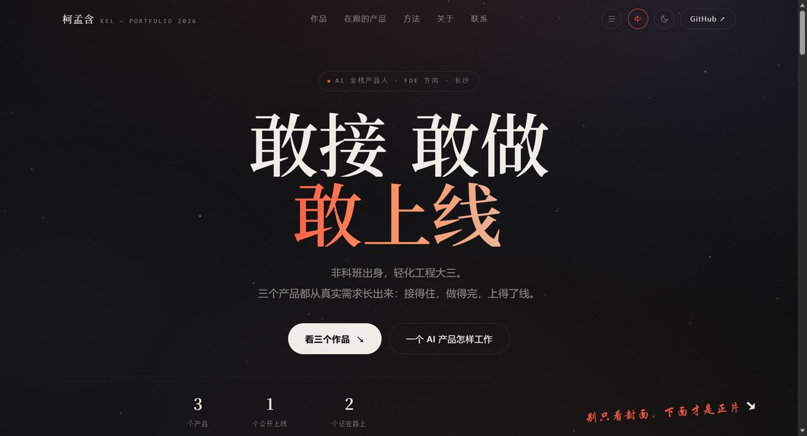

# 柯孟含 Kel — AI 全栈产品人

> 非科班出身，轻化工程大三。三个产品都从真实需求长出来：接得住，做得完，上得了线。

**在线作品集：https://8-321.github.io/kel-portfolio/**



---

## 作品

### 01 第二文化 / PersonaBox — 行为测评 · 亚文化切入 · 已公开上线

有创意 ≠ 有商业模式，有流量 ≠ 有增长。从 MBTI 亚文化切入，把「测一下」做成一个真的愿意被玩完的产品：14 题情境选择，每题都是一个真实社交场景，最后给出人格画像。题目、结果页、分享图推倒重来好几轮。

- **角色**：需求判断 · 增长 · 内容设计
- **技术**：微信小程序 · 云开发 · 支付核验
- **在线**：https://personaboxlab.com

### 02 共享 3D 打印机 — 小程序 · 设备控制 · 原型阶段

需求不是我想出来的，是企业直接给的。小程序做共享打印机租赁：设备控制、三层权限、计费与运维，从接口对接到硬件调试、单片机配置，整条交付链都跟着走完。

- **角色**：需求承接 · 产品设计 · 交付
- **核心**：设备控制 / 三层权限 / 计费
- **技术**：小程序端 · 云函数 · 设备 MQTT 指令
- **现状**：原型可跑 · 未正式上线

### 03 AnPPT — AI 生成 · 可编辑 PPT · 内测中

甲方、运营、技术、我，四个人四种语言。先理清 PPT 的底层逻辑：**版式是数据结构，不是画布**，再把它拆成可生成、可编辑的中间层。架构说不清楚时最贵的不是写代码，是反复返工——所以先画图、再做。

- **角色**：产品研发 · 体验判断 · 持续迭代
- **核心**：生成 → 可编辑的格式转换
- **流程**：一句话/一份文档 → 章节大纲 → 母版与占位 → 可编辑 PPTX 交付
- **现状**：内部在用 · 未公开

### 还在路上

- **白捡 · Freebie Campus** — 校园里免费的东西不该被扔掉。3 公里内、带倒计时、库存真实。
- **校园 π · Campus** — 校园信息聚合：二手、拼单、求助、搭子，先认证在校生再交易。

## 技术栈（实际用到的）

```
小程序   微信小程序原生 · 云开发云函数
硬件     设备 MQTT 指令 · 单片机配置 · 串口调试
前端     HTML / CSS / JS（本作品集手写，无框架）
AI      生成 → 可编辑 PPTX 的格式转换 · 测评题目与结果页设计
```

## 联系

- GitHub：[@8-321](https://github.com/8-321)
- 产品：[personaboxlab.com](https://personaboxlab.com)

---

<sub>单页静态站点 · 无框架 · 手写 CSS 与动画</sub>
